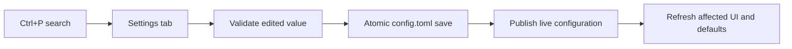

# TermChatUI Architecture

> Generated from GitNexus knowledge graph (637 symbols, 1212 relationships, 33 execution flows).
> The graph-derived inventory is historical; implementation notes below are maintained separately.

## Overview

TermChatUI (TCUI) is a terminal-based chat application built in Rust. It uses `ratatui` for terminal UI rendering, `crossterm` for input handling, `rusqlite` for local persistence, and integrates with LLM providers via HTTP APIs. The architecture follows a classic event-loop pattern with an action dispatch system separating input handling from state mutations.

The codebase consists of **47 source files** organized into 7 major functional areas:

| Area | Files | Role |
|------|-------|------|
| **UI** | 20 | Terminal rendering, layout, widgets, modals, components |
| **App** | 4 | Event loop, action dispatch, state management |
| **Config** | 4 | App settings, API key storage, soul/agent configs |
| **Storage** | 2 | Persistent SQLite metadata and authoritative chat documents |
| **LLM** | 5 | Provider abstraction, HTTP client, streaming, tools |
| **MCP** | 4 | Model Context Protocol client, registry, transport |
| **Obsidian** | 5 | Vault file integration, diff safety, file watcher |

---

## Functional Areas

### 1. App (`src/app/`)

The core application loop lives in `TuiApp` (`src/app.rs`). It owns the event loop (`run`), processes keyboard/mouse input (`handle_key`, `handle_mouse`), and dispatches actions (`dispatch`).

Key types:
- `TuiApp` — Main app struct holding storage, config, UI state, LLM client, vault
- `Action` — Enum of all possible user/system actions (Quit, SendMessage, ToggleSettings, etc.)
- `Message` — Chat message model (role, content, thinking, tool calls, images)
- `Tab` — Chat tab configuration (provider, model, endpoint, soul, agent)

The event loop (`run`) uses `tokio::select!` to concurrently handle:
- Terminal tick (33ms redraw)
- Crossterm key/mouse/resize events
- Async actions from the action channel

### 2. UI (`src/ui/`)

All rendering is pure and stateless per frame. The `UI` struct (`src/ui/mod.rs`) holds mutable tab state and orchestrates the layout:

```
┌─ Top Bar (tabs, hamburger, close) ─┐
├─ Sidebar ─┼─ Chat Area ───────────┤
│           │  Messages             │
│           │  Input                │
├─ Status Bar (connection, MCPs) ──┘
```

**Widgets:**
- `top_bar.rs` — Tab bar with clickable tabs, hamburger menu, close button
- `sidebar.rs` — Conversation list, New Chat button, Settings button
- `chat_tab.rs` — Message list, input box, provider/model selector
- `status_bar.rs` — Connection status, MCP server indicators
- `settings_workspace.rs` — Categorized live settings, validation, field editing, and keyboard binding capture; `tui/settings_panel.rs` is the search-only navigator.
- `terminal_workspace.rs` — Persistent PTY sessions, terminal tab/split presentation, focus, and draggable divider geometry.
- `command_blocks.rs` / `command_review.rs` — Closed shell-fence extraction and explicit selected-command review; no execution during rendering.
- `session_list.rs` — Session/conversation switcher
- `obsidian_tab.rs` — Obsidian vault file tree and preview

**Modals:**
- `quit_confirm.rs` — Exit confirmation
- `new_tab.rs` — Create new chat tab
- `mcp_config.rs` — MCP server configuration
- `help.rs` — Keyboard shortcuts help
- `confirm_diff.rs` — Code diff review modal

**Components:**
- `chat_message.rs` — Individual message bubble rendering
- `markdown.rs` / `markdown_model.rs` — Shared Markdown rendering and block parsing.
- `markdown_rich.rs` — Boxed tables and bounded, cached `merman-core` / `merman-ascii` flowchart rendering.
- `markdown_flowchart.rs` — Bounded, width-aware ranked recovery layout with multiple columns, continuous directional edges, and inline labels; narrow or grouped diagrams retain stacked recovery with nested group frames.
- `markdown_charts.rs` — Mermaid XY/bar/line and pie semantic models rendered through native Ratatui charts/canvas, with bounded parsing, series, samples, and cells.
- `markdown_code.rs` — Lossless preformatted wrapping, display-width-aware tab expansion, and recognizable text-frame normalization/reflow. Copying remains source-based.
- `diff_view.rs` — Side-by-side diff display
- `image_block.rs` — Image display in chat
- `collapsible.rs` — Collapsible sections (e.g., thinking blocks)

`notifications.rs` selects Herdr, a reachable local notification service, or a
known direct-terminal OSC protocol. SSH never targets server D-Bus. Helpers
have captured, bounded output and deadlines; unavailable routes disable desktop
delivery. Detached reminders preserve only the explicit SSH/Herdr routing context.

### 3. Storage (`src/storage/`)

`Storage::new` opens the persistent `tcui.db` through `rusqlite` (bundled).
Provider/model/settings and credential metadata remain in that on-disk database;
the whole application database is **not** an in-RAM SQLite database.
`tcui_credential_vault` holds password derivation/wrapping metadata and preferences,
while `tcui_credentials` holds mixed plaintext/encrypted provider and search
records plus always-encrypted machine secrets.

Authoritative chat history is stored as per-conversation documents in
`$XDG_DATA_HOME/tcui/chats`, not the legacy `messages`/`conversations` SQL rows.
Documents are encrypted only when chat protection is selected. Migration archives
legacy SQL chat content to Trash, deletes migrated rows, and runs `VACUUM`;
archives and prior backups may remain readable. The legacy `chat.key` remains
for legacy content/reminders and cannot unlock new protection envelopes.
New legacy shared-key files are created exclusively with mode 0600 before writing
and keep the existing final 0400 mode. Existing key bytes and formats do not change.

Reminder metadata remains in `$XDG_DATA_HOME/tcui/reminders.toml`. Its stable
`.reminders.lock` serializes readers and complete read-modify-write operations
across TCUI processes. Writers reload under the lock and replace only their
record, so different-record changes merge; same-ID changes use lock order.
Metadata uses private, no-follow, atomic durable replacement with checked rollback.
systemd unit operations remain outside this metadata-only transaction.

Native Memory lives independently in `$XDG_DATA_HOME/tcui/memories`, with chat
and Memory Trash under each store's `.trash`. When protected, its serialized
SQLite search index is encrypted on disk and loaded into an in-RAM query database
without plaintext SQLite sidecars. Corrupt caches do not prevent source reads or
listing; explicit repair rebuilds the index without changing source records.

The built-in **TCUI Internal** profile is the fresh-configuration default, rooted at
`$XDG_DATA_HOME/tcui/vault` and owns canonical Saved files and downloaded/chat
artifacts. Vault protection covers its content, backups, link manifests, journals,
and stages; external profiles are ordinary plaintext folders. Native confirmed
copies preserve source files and chat links, including exact binary bytes.
Protected shared journals defer startup recovery while locked and reject
journal-backed mutations, including external-only operations, until unlock.
Policy migration recovers pending operations under the old policy first.

On Linux `$XDG_DATA_HOME` defaults to `~/.local/share`; the database is therefore
normally `~/.local/share/tcui/tcui.db`. Filenames, paths, configuration, profile
names, logs, and general database metadata are not covered by content protection.

### 4. Config (`src/config/`)

- `app_config.rs` — `AppConfig` (TOML serialized), default provider/model, vault path, tab configs. Stored at `~/.config/tcui/config.toml`.
- `key_store.rs` — Explicit per-record SQLite credential storage, shared password lifecycle, API/OAuth records, and opt-in legacy import. Argon2id protects the random master secret; selected content uses domain-separated AES-GCM envelopes. Plaintext/encrypted provider and search records coexist; machine secrets always remain encrypted.
- `soul.rs` — Soul/agent personality configuration loading

Configuration load/save keeps its Result API and stable `.config.lock`.
The existing writer uses no-follow directory capabilities, exclusively created
0600 sibling stages, file sync, atomic rename, directory sync, and checked rollback.
Backups are published complete without replacing an existing regular backup.
Cleanup checks retained file identities and does not remove a replaced entry.
New directories are 0700. Config, backup, lock, and parent symlinks are rejected;
cooperating processes must keep the stable lock file in place. This is not an
isolation boundary against another process that can replace the user's files.
Configuration load resolves both configuration and data roots before writing.
Missing or relative discovered roots return errors; config and reminder metadata
do not fall back to CWD. This IO hardening does not change config serialization's
separate unknown-field/comment preservation limits.

### 5. LLM (`src/llm/`)

- `client.rs` — `LlmClient` with async `set_api_key`, holds `ClientConfig` (provider, model, API keys HashMap)
- `provider.rs` — `Provider` enum (OpenAI, Anthropic, Gemini, Ollama, Custom) with endpoint URLs
- `stream.rs` — Streaming response handling
- `tools.rs` — LLM tool/function call definitions
- `auth/tui.rs` — Cancellable native OpenAI/Codex and OpenRouter PKCE login flows. Authorization URLs are displayed without host-browser launch; masked response input and loopback callbacks share validation, cancellation, and deadlines.
- `anthropic_sdk.rs` — Official Claude CLI subprocess transport using a saved Console API key, isolated configuration, and `--bare`.
- `app/credential_manager.rs` — `/providers`, `/connect`, and `/vault` masked input and lifecycle UI. Provider selectors contain saved connections rather than automatically seeded presets.

Provider authentication does not read environment keys, `.env`, or another
application's login files. Credential vault access is independent of Markdown
Vault; `/vault-search` retains Markdown search.

Supported endpoints:
| Provider | Endpoint |
|----------|----------|
| OpenAI | `https://api.openai.com/v1` |
| Anthropic | `https://api.anthropic.com/v1` |
| Gemini | `https://generativelanguage.googleapis.com/v1` |
| Ollama | `http://localhost:11434/v1` |

### 6. MCP (`src/mcp/`)

Model Context Protocol integration for external tool servers:
- `client.rs` — Bounded discovery/calls, credential redaction before result truncation, deadlines, and session cleanup.
- `registry.rs` — Disabled-by-default presets and lossless merging of configured/custom server rows.
- `transport.rs` — Explicit stdio commands or native streamable HTTP, KeyStore-only service credentials, official-origin binding, and disabled HTTP redirects.
- `search.rs` — Exa, Tavily, and Firecrawl adapters discover and call only their supported read-only search tools; no model-selected crawl or execution tools.

`search.rs` at the source root dispatches the configured backend and bounds
untrusted request-only evidence. `search/local.rs` queries DuckDuckGo Lite
directly or a configured JSON-enabled SearXNG endpoint. Automatic search is
off by default; explicit search skills bypass that toggle, share a search for
the same backend, and suppress duplicate automatic searches. Failures provide
unavailable evidence rather than silently falling back. The Web search settings
category and credential manager own backend selection, result limits, service
keys, and profile enablement; no environment API-key discovery occurs.

### 7. Obsidian (`src/obsidian/`)

File-based knowledge vault integration:
- `vault.rs` — File listing, reading, searching, writing
- `safety.rs` — Diff generation, backup creation, diff review parsing
- `watcher.rs` — File system change monitoring (`notify` crate)

---

## Key Execution Flows

### 1. Main → Event Loop → Render

```
main (src/main.rs)
  → setup_terminal (crossterm raw mode, alternate screen)
  → create one EventStream shared by security screens and app restarts
  → first-run protection selection; mandatory unlock gate when required
  → open config/stores and construct TuiApp
  → TuiApp::run
      → terminal.draw(|f| UI::render(f))
      → tokio::select!
          ├─ tick.tick()        → redraw
          ├─ crossterm events   → handle_key / handle_mouse
          └─ action_rx          → dispatch(action)
```

The mandatory gate runs before config/stores when app-entry or chat protection
is selected; cancelling exits. Optional-domain unlock cancellation keeps those
domains locked without closing usable surfaces. `/security`, `/unlock`, and
`/lock` use the outer restart loop rather than constructing competing terminal
event readers. The old app/session is dropped and its frame cleared before the
next security screen. Voluntary transitions confirm disposal of running
terminals, unsaved editors, and drafts, quiesce tracked producers, and persist
state; cancellation preserves the session. Forced revocation fails closed.

This is the primary cross-community flow spanning **App → UI**.

### 2. Live Settings → Atomic Configuration



`app/settings.rs` holds the live configuration lock through validation and save.
Failed writes leave the previous configuration active and preserve the editing
draft. Credentials and vault profiles use their dedicated managers. Runtime
consumers read updated configuration; defaults apply to new conversations and
terminal sessions, and recovery retention applies at the next recovery pass.

`app/terminal_workspace.rs` owns the command approval boundary. Run consumes an
explicit review and starts a clean, interpreter-matched PTY only after approval;
existing terminals accept explicit paste without submission. The shared
`TerminalEditorState` transport waits for a random prompt marker before approved
execution. It reserves input capacity, writes the exact approved text to an
exclusive owner-only temporary file, and submits one quoted source invocation.
Commands are never queued as terminal typeahead: interactive programs retain
TTY input while the shell reads code from the file. Sourcing preserves directory
and variable changes. Files are removed on normal session teardown; forced
process termination can leave them behind. The transport bounds input/output and
scrollback, suppresses host OSC side effects, and tears down PTY jobs on confirmed close.

### 3. Chat Render Pipeline

```
run (src/app.rs)
  → UI::render (src/ui/mod.rs)
      → TopBar::render (src/ui/top_bar.rs)
          → render_tabs
      → Sidebar::render (src/ui/sidebar.rs)
      → ChatTab::render (src/ui/chat_tab.rs)
          → render_title
          → render_provider_model
          → render_messages
          → render_centered_input
      → StatusBar::render (src/ui/status_bar.rs)
```

Each frame rebuilds the layout tree and renders all visible widgets.

### 4. Send Message → Storage

```
handle_key → Enter
  → Action::SendMessage(content)
      → dispatch
          → persist authoritative conversation document
          → UI::add_message
          → (first message?) generate_title
              → UI::add_chat_to_active_tab(title)
```

### 5. Explicit Connection → Credential Store

`/providers` and `/connect` open the credential manager. The user selects a
preset or custom endpoint, chooses encrypted or plaintext provider storage,
and supplies an API key or completes OAuth. The manager saves credentials
through `KeyStore`, persists provider metadata, and refreshes model selectors.

OpenAI OAuth discovery fetches the authenticated subscription catalog using a
pinned upstream protocol version, not TCUI's version or external Codex files.
Successful refreshes replace stale selections while preserving session-local
manual overrides; failures retain the last saved catalog. Credential resolution
reads the XDG-scoped vault without taking the unrelated configuration-file lock.

Connection storage is explicit per record; encrypted and plaintext records may
coexist and resolve by exact IDs. `/vault` defaults affect new records without
silently converting old ones. Changing the credentials checkbox in `/security`
intentionally converts provider/search records and updates the default;
unchanged selection preserves explicit exceptions. First encrypted enrollment
after plaintext-only setup requires the shared password before reopening
`/connect`. `/unlock` unlocks all selected domains. No environment or external-login
scan occurs. See [Authentication](docs/auth.md).

---

## Mermaid Architecture Diagram

```mermaid
flowchart TB
    subgraph Entry["Entry Point"]
        M["main.rs\nsetup_terminal\nrestore_terminal"]
    end

    subgraph AppLayer["App Layer"]
        A["TuiApp (app.rs)"]
        Act["Action Enum (action.rs)"]
        Msg["Message (message.rs)"]
        Tab["Tab (tab.rs)"]
    end

    subgraph UI["UI Layer (ratatui)"]
        U["UI (mod.rs)"]
        TB["TopBar"]
        SB["Sidebar"]
        CT["ChatTab"]
        ST["StatusBar"]
        SET["SettingsPopup"]
        MOD["Modals"]
        COMP["Components\nmarkdown, diff, image"]
    end

    subgraph Storage["Storage Layer"]
        DB["Storage (db.rs)\nSQLite: messages, conversations,\nsettings, tabs, mcp_servers"]
    end

    subgraph Config["Config Layer"]
        AC["AppConfig (TOML)"]
        KS["KeyStore"]
        SOUL["Soul Config"]
    end

    subgraph LLM["LLM Layer"]
        LC["LlmClient"]
        PRV["Provider Enum"]
        STR["Stream"]
        TOOL["Tools"]
    end

    subgraph MCP["MCP Layer"]
        MC["McpClient"]
        REG["Registry"]
        TRN["Transport"]
    end

    subgraph Obsidian["Obsidian Layer"]
        VAULT["Vault"]
        SAFE["Safety (diff/backup)"]
        WATCH["File Watcher"]
    end

    M --> A
    A -->|dispatch| Act
    A -->|render frame| U
    A -->|read/write| DB
    A -->|load/save| AC
    A -->|set keys| KS
    A -->|chat| LC
    A -->|tools| MC
    A -->|vault| VAULT

    U --> TB
    U --> SB
    U --> CT
    U --> ST
    U --> SET
    U --> MOD
    CT --> COMP

    LC --> PRV
    LC --> STR
    LC --> TOOL

    MC --> REG
    MC --> TRN

    VAULT --> SAFE
    VAULT --> WATCH

    style Entry fill:#f9f,stroke:#333
    style AppLayer fill:#bbf,stroke:#333
    style UI fill:#bfb,stroke:#333
    style Storage fill:#fbb,stroke:#333
    style Config fill:#ffb,stroke:#333
    style LLM fill:#bff,stroke:#333
    style MCP fill:#fbf,stroke:#333
    style Obsidian fill:#eee,stroke:#333
```



---

## Data Flow Summary

| Flow | Direction | Persistence |
|------|-----------|-------------|
| User input → Action → UI update | In-memory | None |
| Chat messages and conversations | App ↔ document store | Per-conversation files under `tcui/chats`, optionally encrypted |
| Provider/model/settings metadata | App ↔ Storage | Persistent `tcui.db` |
| Credentials | App ↔ KeyStore | Per-record plaintext/encrypted SQLite records; machine secrets encrypted |
| App config (provider, model, theme) | Disk → App | TOML (`~/.config/tcui/config.toml`) |
| Memory sources / search | App ↔ native Memory | `tcui/memories`; protected serialized index encrypted on disk, queried in RAM |
| LLM streaming | LLM → UI | Saved response content follows destination chat policy |
| Vault file operations | App ↔ configured profile | Optional encryption for TCUI Internal; external folders plaintext |

---

## Key Design Decisions

1. **Action dispatch pattern** — All user input is converted to `Action` enums and dispatched through a single `dispatch` method. This centralizes side effects and makes the UI layer purely presentational.

2. **Frame-based rendering** — The entire UI is redrawn every 33ms (30 FPS) via `terminal.draw`. No widget retains internal rendering state; all layout is computed from `UI` and `ChatTabState`.

3. **Separate content stores and metadata** — Authoritative chat documents and native Memory records are independent of persistent SQLite provider/model/settings metadata. Protection is selective, not whole-config or whole-database encryption; copies into chats, exports, or LLM requests follow destination rules and cannot recall provider-sent data.

4. **Provider abstraction** — The `Provider` enum maps display names to base URLs. Custom providers are supported via free-form endpoint + key inputs.

5. **Event loop concurrency** — `tokio::select!` combines crossterm events, timed ticks, and async action channels without blocking the UI thread.
